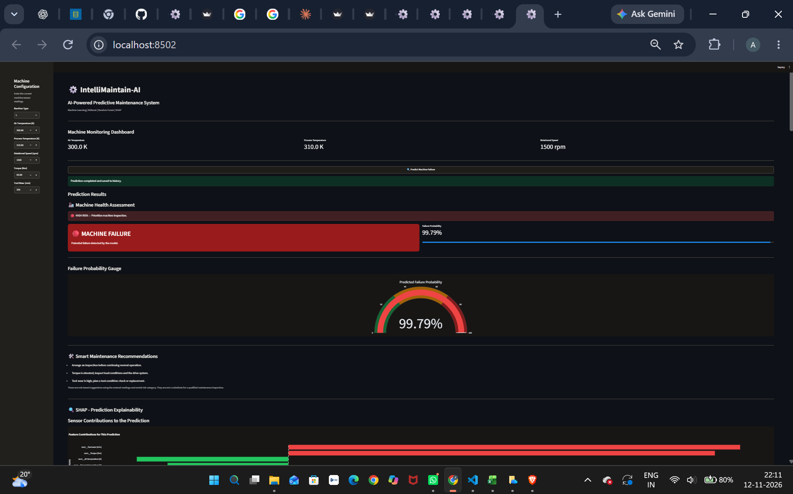
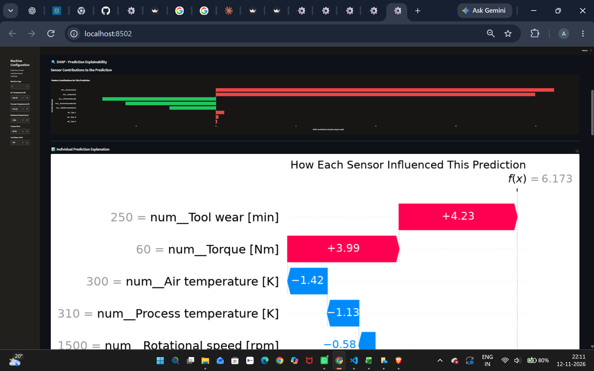
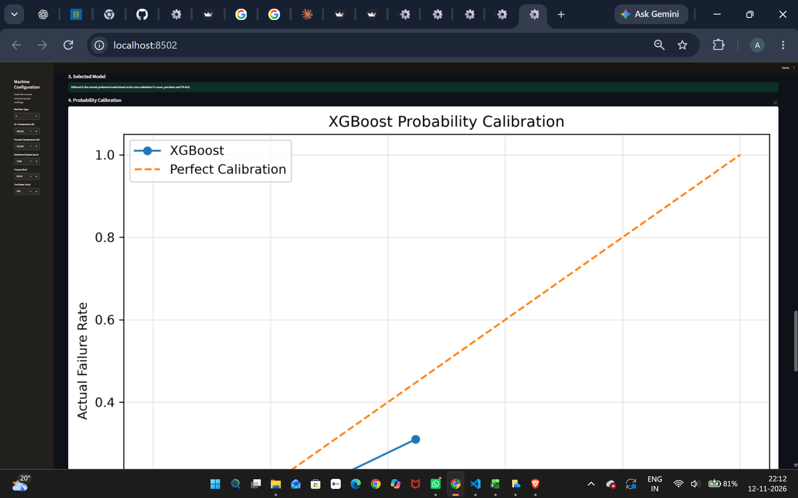
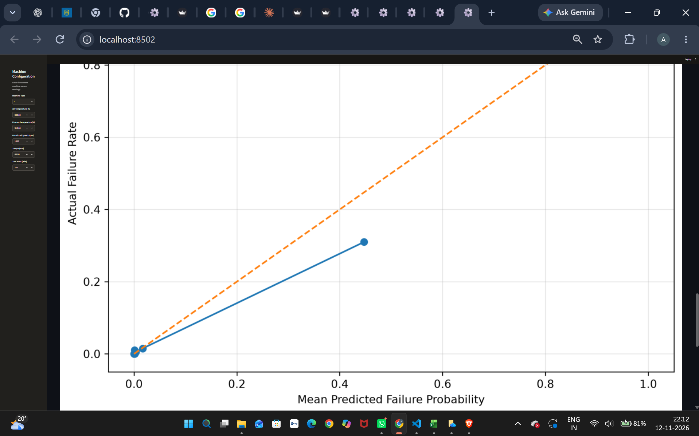

# ⚙️ IntelliMaintain-AI
### AI-Powered Predictive Maintenance System

IntelliMaintain-AI is a machine learning-based predictive maintenance system that analyzes machine sensor readings to identify potential equipment failures.

The project uses Random Forest and XGBoost models to predict machine failures and provides explainable predictions using SHAP.

## 🚀 Features

- Machine failure prediction using XGBoost
- Random Forest and XGBoost model comparison
- Five-fold stratified cross-validation
- Failure probability visualization
- SHAP-based model explainability
- Individual prediction waterfall plots
- Rule-based maintenance recommendations
- Prediction history with CSV download
- Interactive Streamlit dashboard
- Model evaluation and calibration reports

## 🛠️ Technologies Used

| Category | Technologies |
|---|---|
| Language | Python |
| Machine Learning | Scikit-learn, XGBoost |
| Data Processing | Pandas, NumPy |
| Explainable AI | SHAP |
| Visualization | Matplotlib, Plotly |
| Dashboard | Streamlit |
| Model Storage | Joblib |
| Dataset | UCI AI4I 2020 |

## 📊 Dataset

**UCI AI4I 2020 Predictive Maintenance Dataset**

- Total records: 10,000
- Training records: 8,000
- Testing records: 2,000
- Normal test cases: 1,932
- Failure test cases: 68

### Selected Features

1. Machine Type
2. Air Temperature
3. Process Temperature
4. Rotational Speed
5. Torque
6. Tool Wear

Target variable: `Machine failure`

## 🤖 Model Performance

### Five-Fold Cross-Validation

| Metric | Random Forest | XGBoost |
|---|---:|---:|
| Precision | 54.16% | 69.77% |
| Recall | 76.75% | 76.77% |
| F1-score | 63.42% | 73.00% |
| ROC-AUC | 97.09% | 97.05% |
| PR-AUC | 70.65% | 76.96% |

XGBoost is the current preferred model based on its stronger precision, F1-score and PR-AUC.

### XGBoost Test Results

| Metric | Score |
|---|---:|
| Accuracy | 97.90% |
| Precision | 65.48% |
| Recall | 80.88% |
| F1-score | 72.37% |
| ROC-AUC | 97.48% |
| PR-AUC | 83.91% |
| Brier Score | 0.0152 |

## 🔍 Explainable AI with SHAP

SHAP is used to understand how individual sensor readings influence model predictions.

The dashboard provides:
- Feature contribution bar chart
- Individual prediction waterfall plot
- Top influential features

These explanations describe model behaviour and do not establish causal relationships.

## 📈 Interactive Dashboard

### Dashboard Preview



### SHAP Explainability



### Model Performance Comparison



### Probability Calibration




The Streamlit dashboard provides:

- Machine sensor input
- Failure prediction and risk assessment
- Failure probability gauge
- Maintenance recommendations
- SHAP explanations
- Prediction history
- Prediction analytics
- Model performance comparison
- Calibration visualization
- Evaluation report

### Dashboard Screenshots


## 📁 Project Structure

```text
intellimaintain-ai/
│
├── data/
│   ├── raw/
│   └── processed/
│
├── models/
│   └── explanations/
│
├── notebooks/
│
├── src/
│   ├── preprocessing.py
│   ├── train.py
│   ├── predict.py
│   ├── explain.py
│   ├── validate.py
│   ├── compare_models.py
│   ├── calibrate_model.py
│   └── generate_report.py
│
├── dashboard/
│
├── reports/
│   └── model_evaluation_report.md
│
├── app.py
├── requirements.txt
├── README.md
└── .gitignore
```

## ⚙️ Installation and Setup

### 1. Clone the repository

```bash
git clone YOUR_GITHUB_REPOSITORY_URL
cd intellimaintain-ai
```

### 2. Create a virtual environment

```bash
python -m venv .venv
```

### 3. Activate the environment

Windows PowerShell:

```powershell
.\.venv\Scripts\Activate.ps1
```

### 4. Install dependencies

```bash
pip install -r requirements.txt
```

### 5. Run the dashboard

```bash
streamlit run app.py
```

Open the local URL displayed in the terminal.

## 📋 Model Evaluation

Run the following scripts from the project root:

```bash
python src/validate.py
python src/compare_models.py
python src/calibrate_model.py
python src/generate_report.py
```

The evaluation report is generated inside the `reports` folder.

## ⚠️ Limitations

- The dataset is imbalanced.
- Model performance on the benchmark dataset may not generalize to all industrial machines.
- The test dataset has already been used for model comparison.
- Probability calibration requires further investigation.
- Maintenance recommendations are illustrative rule-based suggestions and are not manufacturer-validated.

## 🔮 Future Improvements

- Real-time sensor integration
- IoT-based machine monitoring
- Improved probability calibration
- Remaining Useful Life (RUL) prediction
- Cloud deployment
- Automated maintenance scheduling
- Integration with industrial monitoring systems

## 👩‍💻 Author

**Anushriya R**

BE – Artificial Intelligence and Machine Learning

National Institute of Engineering, Mysuru
